<!-- nav -->
[Guide index](README.md) · [Intro](01-introduction.md) · [Planning](02-planning.md) · [VMs](03-hosts.md) · [Services](04-services.md) · **LTM objects** · [WAF policy](06-waf-policy.md) · [Antivirus](07-antivirus.md) · [Validator hop](08-validator-hop.md) · [Entry point](09-entry-point.md) · [Tests](10-acceptance.md) · [Operations](11-operations.md) · [Showcase](12-showcase.md) · [Appendices](13-appendix.md)

---
<!-- /nav -->

# BIG-IP building blocks

These are ordinary LTM objects. Screenshots show the *Create* form filled in
with the values from the test build, with the changed fields outlined in
red. Use your own worksheet values where a placeholder appears.

Log in to the Configuration utility at `https://<bigip-mgmt>/`.

## Check the BIG-IP is ready

| Screen | You should see |
|---|---|
| **System › Resource Provisioning** | *Local Traffic (LTM)* and *Application Security (ASM)* at **Nominal**. If ASM is at None, set it to Nominal and click **Submit**. The system restarts services and logs you out for about a minute |
| **System › License** | Advanced WAF listed, and a licence that has not expired |
| **Network › Self IPs** | A self IP on the VLAN that holds `<vip>` |

## Partition

A partition keeps the lab's objects together.

**System › Users › Partition List › Create**

| Field | Value |
|---|---|
| Partition Name | `CSV` |
| Description | `CSV upload validation lab` |

Click **Finished**. Then set the **Partition** selector at the top right of
the page to **CSV** and leave it there for the rest of the build. If an
object later turns up in *Common*, this is the step that was missed.

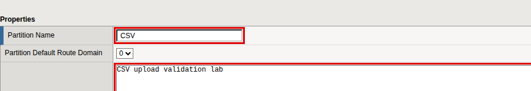

## Routes to the lab hosts

Skip this section if `<lab-host>` and `<av-host>` are on VLANs the BIG-IP is
directly connected to. Otherwise create one route for each host that is not.

**Network › Routes › Add**

| Field | Value |
|---|---|
| Name | `csv_lab_host` (and `csv_lab_icap_av` for the antivirus host) |
| Destination | `<lab-host>` |
| Netmask | `255.255.255.255` |
| Resource | **Use Gateway...** |
| Gateway Address | `<gateway>` |

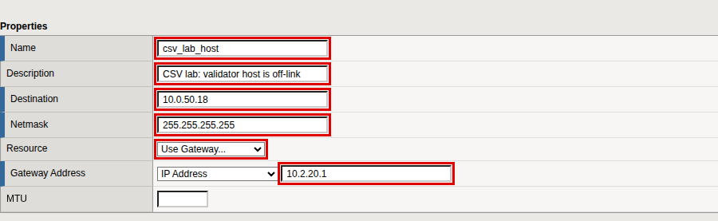

## Certificate and key

Import the key, then the certificate, under the same name so that the BIG-IP
pairs them.

**System › Certificate Management › Traffic Certificate Management › SSL
Certificate List › Import**

1. **Import Type** *Key*. **Key Name** *New*, `csv_lab`. **Key Source**
   *Upload File*, choose `server.key`. Click **Import**.
2. **Import** again. **Import Type** *Certificate*. **Certificate Name**
   *New*, `csv_lab`. **Certificate Source** *Upload File*, choose
   `server.crt`. Click **Import**.

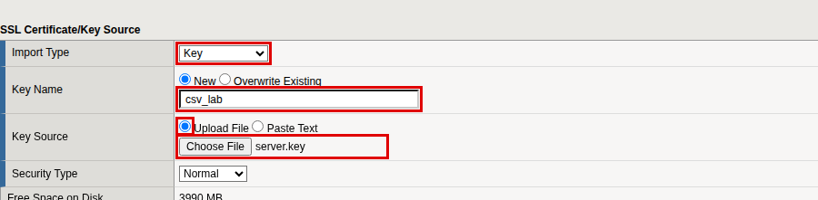

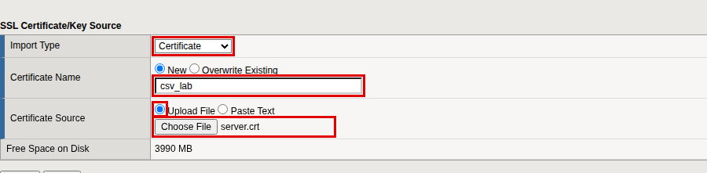

**You should see** `csv_lab` in the list with both a certificate and a key,
and `<vip>` in its subject alternative name.

## Client SSL profile

**Local Traffic › Profiles › SSL › Client › Create**

| Field | Value |
|---|---|
| Name | `clientssl_csv_lab` |
| Parent Profile | `clientssl` |
| Certificate Key Chain | Tick **Custom**, click **Add**. Certificate `csv_lab`, Key `csv_lab`, Chain *None*. Click **Add** |

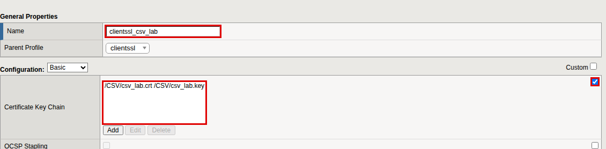

## HTTP profile

The lab services log the real client address. This profile passes it to them
in the `X-Forwarded-For` header.

**Local Traffic › Profiles › Services › HTTP › Create**

| Field | Value |
|---|---|
| Name | `http_csv_lab` |
| Parent Profile | `http` |
| Insert X-Forwarded-For | Tick **Custom**, set **Enabled** |

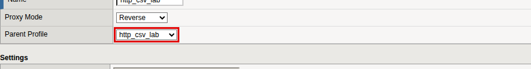

## Health monitors

Two monitors, one per service. Type the `\r\n` sequences exactly as shown.

**Local Traffic › Monitors › Create**

| Field | `mon_csv_validator` | `mon_csv_sink` |
|---|---|---|
| Type | *HTTP* | *HTTP* |
| Interval / Timeout | `5` / `16` | `5` / `16` |
| Send String | `GET /ready HTTP/1.1\r\nHost: csv-validator\r\nConnection: close\r\n\r\n` | `GET /health HTTP/1.1\r\nHost: csv-sink\r\nConnection: close\r\n\r\n` |
| Receive String | `status.:.ready` | `status.:.ok` |
| Alias Service Port | `8080` | leave `*` |

The validator pool member is its ICAP port, which an HTTP monitor cannot
speak to. The alias port points the monitor at the validator's health
address instead, which reports whether the ICAP listener is serving.

The receive strings use dots where the services send double quotes
(`{"status":"ready"}`). The BIG-IP drops double quotes from a receive string,
so a pattern without them is used.

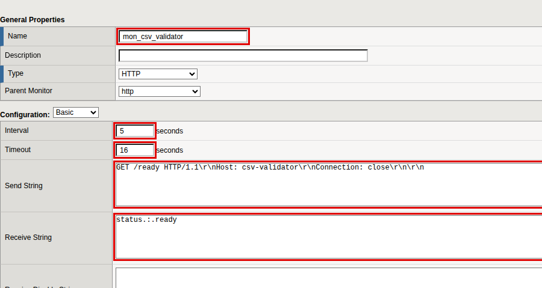

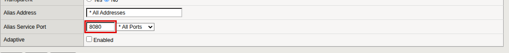

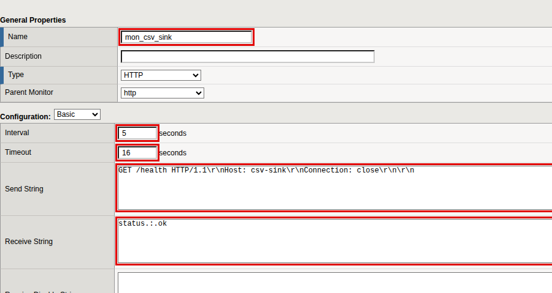

## Pools

**Local Traffic › Pools › Pool List › Create**

| Field | `pool_csv_validator_icap` | `pool_csv_sink` |
|---|---|---|
| Health Monitors | `mon_csv_validator` | `mon_csv_sink` |
| New Members: Address | `<lab-host>` | `<lab-host>` |
| New Members: Service Port | `1345` | `8081` |

Click **Add** for the member, then **Finished**.

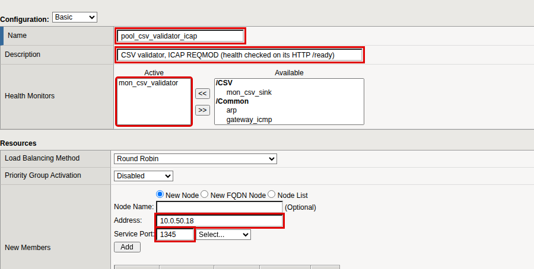

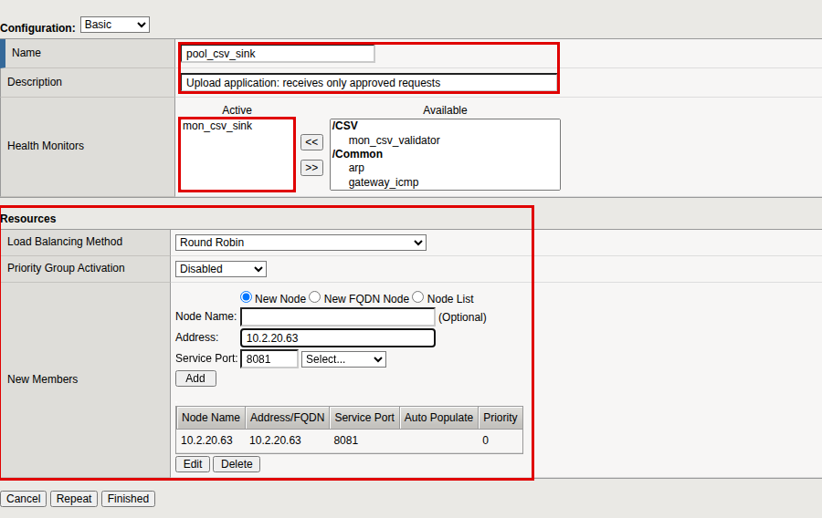

**You should see** both pools turn green within a few seconds. A red pool
means the BIG-IP cannot reach the service from a self IP: check the route
above, any firewall between them, and that the services are running.

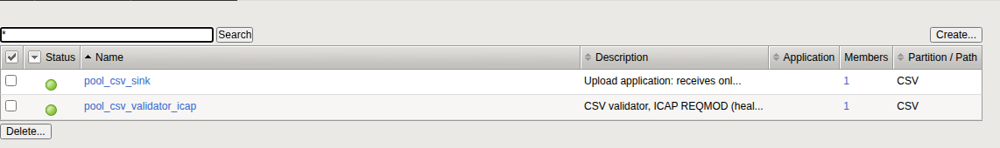

<!-- nav -->
---
← [Build the lab services](04-services.md) &nbsp;|&nbsp; [Guide index](README.md) &nbsp;|&nbsp; [The Advanced WAF policy](06-waf-policy.md) →
<!-- /nav -->
