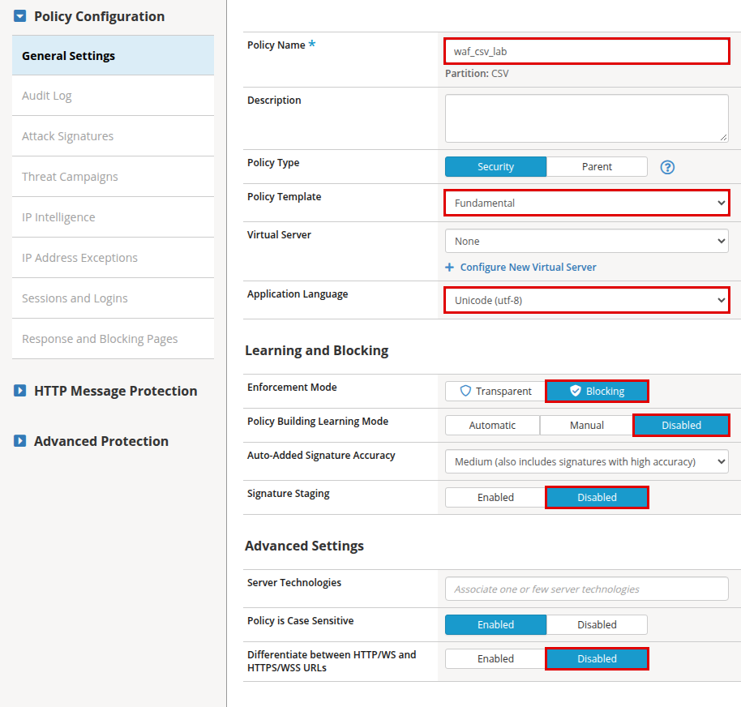
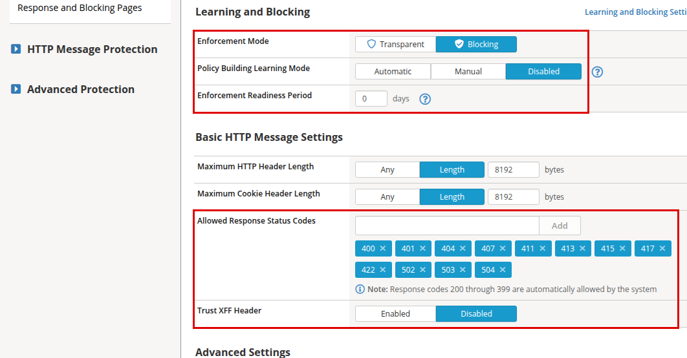
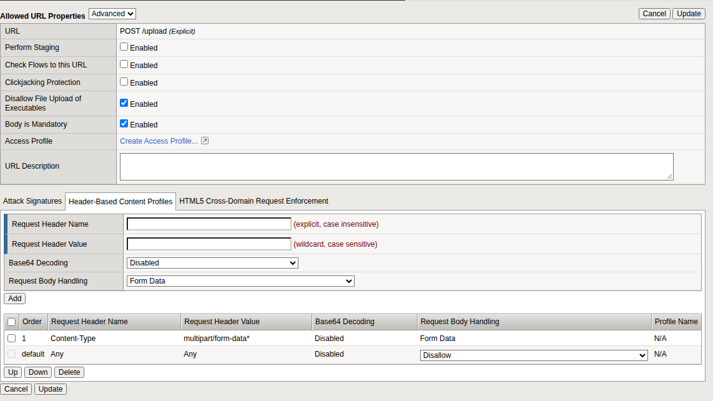
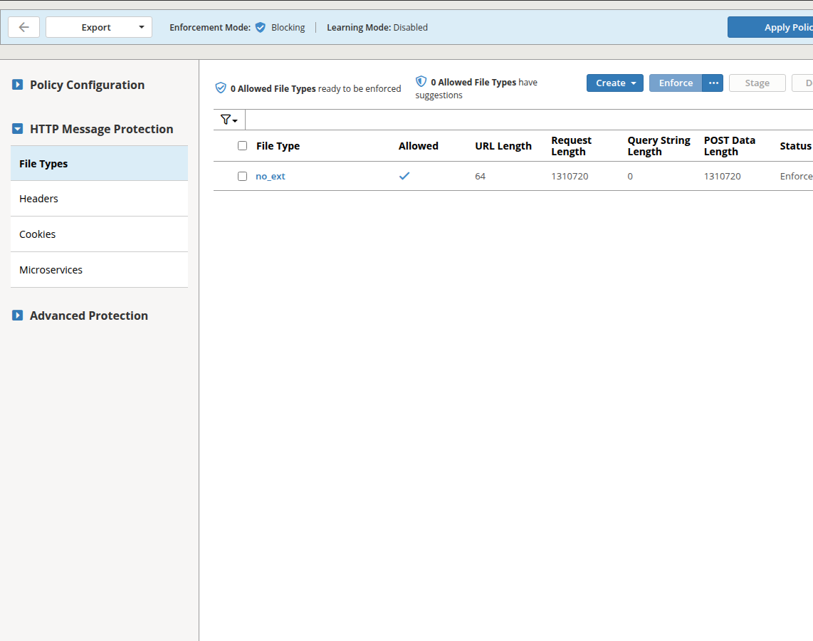
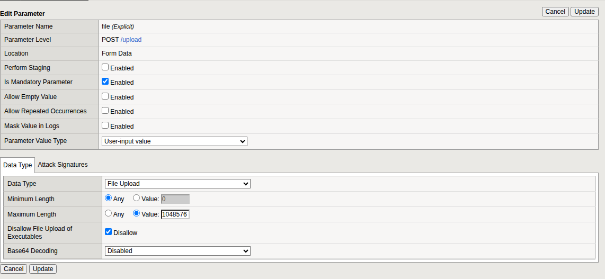
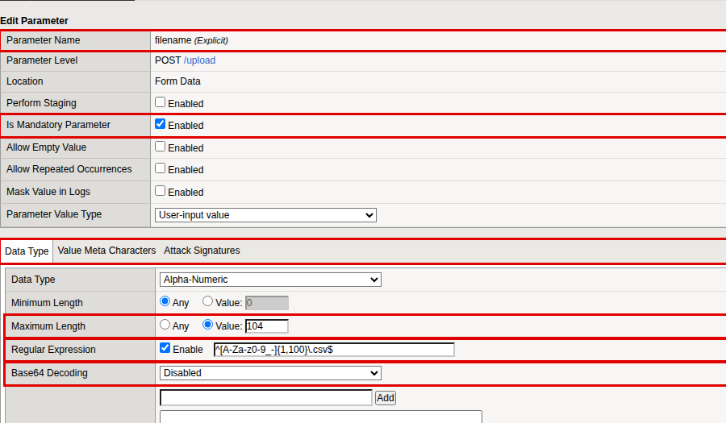
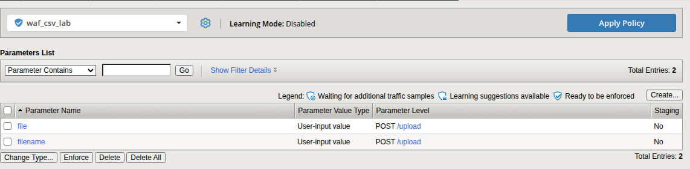
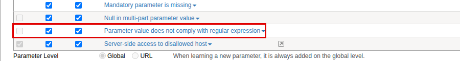
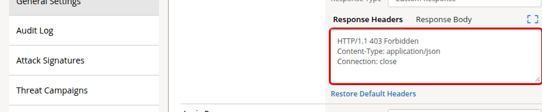

<!-- nav -->
[Guide index](README.md) · [Intro](01-introduction.md) · [Planning](02-planning.md) · [VMs](03-hosts.md) · [Services](04-services.md) · [LTM objects](05-building-blocks.md) · **WAF policy** · [Antivirus](07-antivirus.md) · [Validator hop](08-validator-hop.md) · [Entry point](09-entry-point.md) · [Tests](10-acceptance.md) · [Operations](11-operations.md) · [Showcase](12-showcase.md) · [Appendices](13-appendix.md)

---
<!-- /nav -->

# The Advanced WAF policy

This is the longest chapter. The policy allows exactly one thing, a `POST`
to `/upload` carrying one file in a form field called `file`, and blocks
everything else. Build it in the order given.

## Create the policy

**Security › Application Security › Security Policies › Policies List ›
Create**

| Field | Value |
|---|---|
| Policy Name | `waf_csv_lab` |
| Policy Type | *Security* |
| Policy Template | *Fundamental* |
| Virtual Server | *None*. Chapter 9 turns the policy on |
| Application Language | *Unicode (utf-8)* |
| Enforcement Mode | **Blocking** |
| Policy Building Learning Mode | **Disabled** |
| Signature Staging | **Disabled** |
| Differentiate between HTTP/WS and HTTPS/WSS URLs | **Disabled** |

Click **Save**.

Learning is disabled because nothing in this lab is learned from traffic:
you set every control by hand. Left on its default, the policy would be free
to relax itself.

## General settings

Click the policy name. **General Settings** is the first page.

| Field | Value |
|---|---|
| Enforcement Readiness Period | `0` days |
| Allowed Response Status Codes | Add `411`, `413`, `415`, `422`, `502` and `504` to the defaults |
| Trust XFF Header | *Disabled* |

Click **Save**.

> **Do not skip the response codes.** The validator answers with those codes
> when it rejects a file. A code that is not on this list is a violation in
> its own right, and the WAF would replace the validator's answer with its
> own block page.

## Allowed URL

**Security › Application Security › URLs › Allowed URLs**

1. Tick the wildcard entry `*` and click **Delete**. Any other URL is now
   illegal.
2. Click **Create** and set the **Allowed URL Properties** selector to
   *Advanced*.

| Field | Value |
|---|---|
| URL | *Explicit*, `/upload` |
| Method | *POST* |
| Perform Staging | clear |
| Disallow File Upload of Executables | tick |
| Body is Mandatory | tick |

3. Click **Create**, open `/upload` again, and select the **Header-Based
   Content Profiles** tab. Make it read:

| Order | Request Header Name | Request Header Value | Request Body Handling |
|---|---|---|---|
| 1 | `Content-Type` | `multipart/form-data*` | *Form Data* |
| default | Any | Any | *Disallow* |

Delete the rows for `*json*` and `*xml*`. Click **Update**. A request with
any other content type is now refused.

## Allowed file type

The WAF's "file type" is the extension of the URL, not of the uploaded file.
`/upload` has none, which the WAF calls `no_ext`. This entry carries the
size limits for the whole request.

In the policy, expand **HTTP Message Protection** and click **File Types**.

1. Delete the wildcard `*`.
2. **Create › Allowed File Type**.

| Field | Value |
|---|---|
| File Type | *Explicit*, `no_ext` |
| Perform Staging | clear |
| URL Length | `64` |
| Request Length | `1310720` |
| Query String Length | `0` |
| POST Data Length | `1310720` |

`1310720` bytes is 1.25 MiB: a 1 MiB file plus the multipart wrapping.

## Parameters

**Security › Application Security › Parameters › Parameters List**

Delete the wildcard parameter `*`. From now on, any form field you have not
declared is illegal, which is how a second file or a wrongly named field is
blocked.

Create two parameters, both at **Parameter Level** *URL*, `POST /upload`.

### The file

| Field | Value |
|---|---|
| Parameter Name | *Explicit*, `file` |
| Location | *Form Data* |
| Perform Staging | clear |
| Is Mandatory Parameter | tick |
| Allow Empty Value | clear |
| Allow Repeated Occurrences | clear |
| Parameter Value Type | *User-input value* |
| Data Type | **File Upload** |
| Maximum Length | *Value*, `1048576` |
| Disallow File Upload of Executables | tick |
| Base64 Decoding | *Disabled* |
| Attack Signatures tab | clear *Check attack signatures* |

### The file name

Advanced WAF presents the `filename` of an uploaded file as a form
parameter of that name. Declaring it lets a regular expression enforce the
extension.

| Field | Value |
|---|---|
| Parameter Name | *Explicit*, `filename` |
| Location | *Form Data* |
| Perform Staging | clear |
| Is Mandatory Parameter | tick |
| Allow Empty Value | clear |
| Parameter Value Type | *User-input value* |
| Data Type | *Alpha-Numeric* |
| Maximum Length | *Value*, `104` |
| Regular Expression | tick **Enable**, `^[A-Za-z0-9_-]{1,100}\.csv$` |
| Base64 Decoding | *Disabled* |

The pattern allows letters, digits, underscore and hyphen, then exactly one
lower-case `.csv`. That refuses `report.txt`, `report.csv.exe` and any name
containing a path.

**You should see** exactly two parameters and no wildcard.

## Learning and blocking settings

**Security › Application Security › Policy Building › Learning and Blocking
Settings**

The page is a list of sections; click a name to open it. The bar at the top
must read *Learning Mode: Disabled*. For every violation below, tick
**Alarm** and **Block** and clear **Learn**.

| Section | Violations |
|---|---|
| Attack Signatures | Keep only *Generic Detection Signatures (High/Medium Accuracy)*, Alarm and Block. Clear **Enable Signature Staging** |
| Evasion technique detected | The violation, and these sub-violations: *Directory traversals*, *Multiple decoding* (2 passes), *Bad unescape*, *%u decoding* |
| File Types | *Illegal file type*, *Illegal URL length*, *Illegal request length*, *Illegal POST data length*, *Illegal query string length* |
| General Settings | *Illegal HTTP status in response*, *Request length exceeds defined buffer size*, *Failed to convert character* |
| Headers | *Illegal header length*, *Illegal method* |
| Cookies | *Illegal cookie length* |
| HTTP protocol compliance failed | The violation, and every sub-violation except *Host header contains IP address*, *High ASCII characters in headers* and *Bad host header value*. Set maximum headers `30`, maximum parameters `10`, maximum cookies `10` |
| Parameters | *Disallowed file upload content detected*, *Illegal parameter*, *Illegal parameter location*, *Illegal parameter value length*, *Illegal empty parameter value*, *Illegal repeated parameter name*, *Null in multi-part parameter value*, *Illegal parameter data type*, *Illegal parameter numeric value*, *Illegal static parameter value*, *Mandatory parameter is missing*, **Parameter value does not comply with regular expression** |
| URLs | *Illegal URL*, *Disallowed file upload content detected in body*, *Illegal request content type*, *Mandatory request body is missing* |

Click **Save**.

> **The one most often missed.** *Parameter value does not comply with
> regular expression* is off by default. Without it the file name pattern is
> checked and then ignored, and `report.txt` passes the WAF.

## Blocking response page

By default a blocked request gets an HTML page with status 200. The lab
returns JSON with status 403 instead, which is easier for a client program,
and for the tests, to recognise.

In the policy, **Response and Blocking Pages › Blocking Page Default**.

| Field | Value |
|---|---|
| Response Type | *Custom Response* |
| Response Headers | `HTTP/1.1 403 Forbidden`, `Content-Type: application/json`, `Connection: close`, one per line |
| Response Body | `{"blocked_by":"bigip-asm","support_id":"<%TS.request.ID()%>"}` |

Click **Save**.

## Apply the policy

Click **Apply Policy**, the blue button at the top right, and confirm.

**You should see** `waf_csv_lab` in the Policies List in *Blocking* mode with
no pending-changes marker.

<!-- nav -->
---
← [BIG-IP building blocks](05-building-blocks.md) &nbsp;|&nbsp; [Guide index](README.md) &nbsp;|&nbsp; [Antivirus scanning](07-antivirus.md) →
<!-- /nav -->
