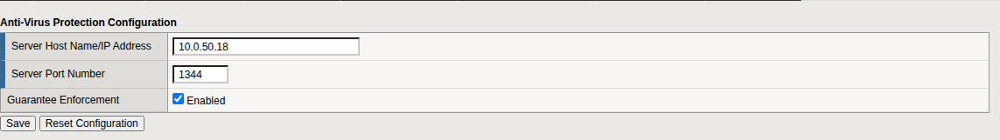

<!-- nav -->
[Guide index](README.md) · [Intro](01-introduction.md) · [Planning](02-planning.md) · [VMs](03-hosts.md) · [Services](04-services.md) · [LTM objects](05-building-blocks.md) · [WAF policy](06-waf-policy.md) · **Antivirus** · [Validator hop](08-validator-hop.md) · [Entry point](09-entry-point.md) · [Tests](10-acceptance.md) · [Operations](11-operations.md) · [Showcase](12-showcase.md) · [Appendices](13-appendix.md)

---
<!-- /nav -->

# Antivirus scanning

Advanced WAF can hand each uploaded file to an antivirus scanner over ICAP
and hold the request until the scanner answers. Three settings are involved:
one for the whole BIG-IP and two in the policy.

## Point the BIG-IP at the scanner

**Security › Options › Application Security › Integrated Services ›
Anti-Virus Protection**

| Field | Value |
|---|---|
| Server Host Name/IP Address | `<av-host>` |
| Server Port Number | `1344` |
| Guarantee Enforcement | tick **Enabled** |

Click **Save**.

*Guarantee Enforcement* makes the WAF block an upload when the scan cannot
be performed. Without it, an unreachable scanner means unscanned files are
delivered.

This is one setting for the whole BIG-IP, shared by every WAF policy on it.
It is not part of the `CSV` partition.



## Restart the Application Security service

> **This step is required and the Configuration utility does not prompt for
> it.** On 21.1.0.2 the WAF reads the antivirus server address only when the
> service starts. In testing, after the address was first set, the BIG-IP
> made no connection to the scanner, logged nothing, and delivered a file
> containing the test virus.

Log in to the BIG-IP command line and run:

```bash
bigstart restart asm
```

Application Security is unavailable for about a minute. Repeat this whenever
you change the antivirus server address or port.

## Turn scanning on in the policy

1. Open `waf_csv_lab` › **General Settings**. Under **Integrated Services**,
   **Anti-Virus Protection**, tick **Scan HTTP Uploads**. Click **Save**.
2. **Policy Building › Learning and Blocking Settings › Antivirus.** Set
   *Virus detected* to **Alarm** and **Block**, with **Learn** clear. Click
   **Save**.
3. Click **Apply Policy**.

You prove the scan in chapter 9, once there is a virtual server to send
uploads to.

<!-- nav -->
---
← [The Advanced WAF policy](06-waf-policy.md) &nbsp;|&nbsp; [Guide index](README.md) &nbsp;|&nbsp; [The validator hop](08-validator-hop.md) →
<!-- /nav -->
