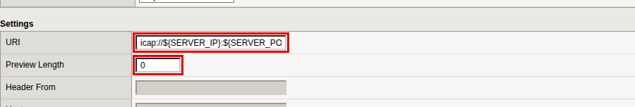
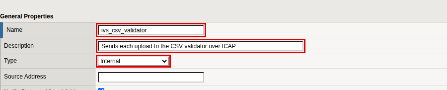
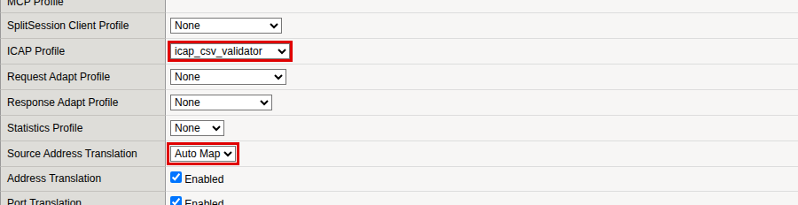
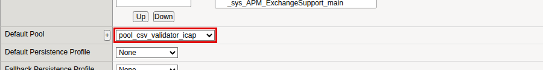
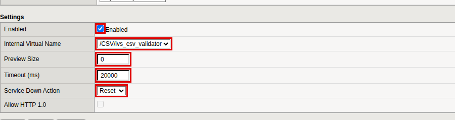
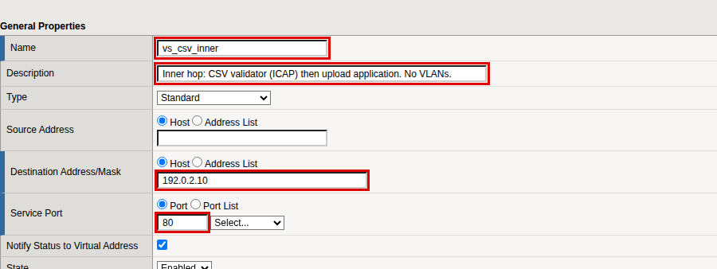
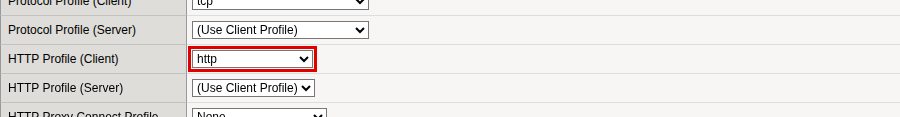

# The validator hop

The BIG-IP feature that sends a request to an outside service for a verdict
is called *request adapt*. It speaks ICAP, the same protocol the antivirus
uses. Four objects make it work, and they must be created in this order,
because each one names the one before.

```
  inner virtual server
      -> request-adapt profile
          -> internal virtual server
              -> ICAP profile + pool of validators
```

## ICAP profile

**Local Traffic › Profiles › Services › ICAP › Create**

| Field | Value |
|---|---|
| Name | `icap_csv_validator` |
| Parent Profile | `icap` |
| URI | Tick **Custom**, `icap://${SERVER_IP}:${SERVER_PORT}/validate` |
| Preview Length | Tick **Custom**, `0` |

Type the URI exactly as shown, including `${SERVER_IP}` and
`${SERVER_PORT}`. The BIG-IP replaces them with the pool member it picks.



## Internal virtual server

An internal virtual server has no address. It exists only so that a
request-adapt profile has somewhere to send traffic.

**Local Traffic › Virtual Servers › Virtual Server List › Create**

Set the **Configuration** selector to *Advanced* so that the ICAP field is
shown.

| Field | Value |
|---|---|
| Name | `ivs_csv_validator` |
| Type | **Internal** |
| ICAP Profile | `icap_csv_validator` |
| Source Address Translation | *Auto Map* |
| Default Pool | `pool_csv_validator_icap` |

Click **Finished**. The type cannot be changed afterwards.







## Request-adapt profile

**Local Traffic › Profiles › Services › Request Adapt › Create**

| Field | Value |
|---|---|
| Name | `reqadapt_csv_lab` |
| Parent Profile | `requestadapt` |
| Enabled | Tick **Custom**, keep ticked |
| Internal Virtual Name | Tick **Custom**, `/CSV/ivs_csv_validator` |
| Preview Size | Tick **Custom**, `0` |
| Timeout (ms) | Tick **Custom**, `20000` |
| Service Down Action | Tick **Custom**, **Reset** |

> **The default fails open.** *Service Down Action* is *Ignore* in the
> parent profile: if the validator is down, requests go straight to the
> application without a verdict. *Reset* closes the connection instead.



## Inner virtual server

This virtual server runs request adapt and then load balances to the
upload application. It is enabled on no VLAN, so nothing on the network can
reach it; only the outer virtual server you build next can.

**Local Traffic › Virtual Servers › Virtual Server List › Create**, with the
**Configuration** selector on *Advanced*.

| Field | Value |
|---|---|
| Name | `vs_csv_inner` |
| Type | *Standard* |
| Destination Address/Mask | `<inner-ip>` |
| Service Port | `80` |
| HTTP Profile (Client) | `http` |
| Request Adapt Profile | `reqadapt_csv_lab` |
| VLAN and Tunnel Traffic | **Enabled on...**, and leave the *Selected* list **empty** |
| Source Address Translation | *Auto Map* |
| Default Pool | `pool_csv_sink` |






**You should see** `ivs_csv_validator` and `vs_csv_inner` in the Virtual
Server List, both available.

## Why there are two virtual servers

It would be simpler to put request adapt on the same virtual server as the
WAF policy. On 21.1.0.2 that runs request adapt *first*: the validator sees
every request before the WAF has had the chance to block it. Splitting the
work across two virtual servers fixes the order. The outer one runs the WAF
and the antivirus; only what survives is forwarded to the inner one.
