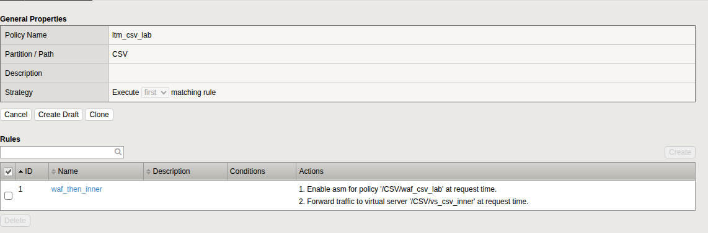
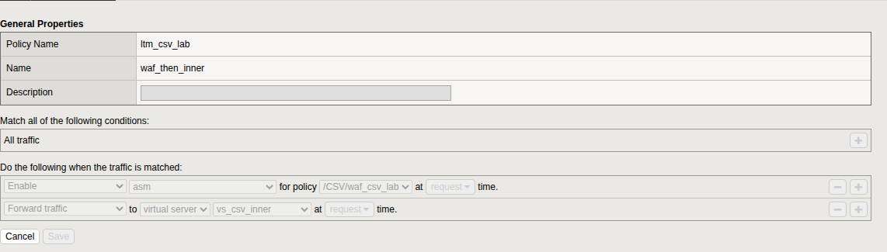
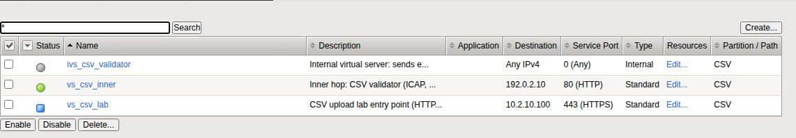

# The entry point

Two objects remain: a policy that strings the steps together, and the
virtual server your clients connect to.

## LTM policy

One rule with two actions: turn on the WAF policy for the request, then
forward the request to the inner virtual server.

**Local Traffic › Policies › Policy List › Create**

1. **Policy Name** `ltm_csv_lab`. **Strategy** *Execute first matching
   rule*. Click **Create Policy**.
2. Under **Rules**, click **Create**. **Name** `waf_then_inner`. Leave the
   condition as *All traffic*.
3. Under **Do the following when the traffic is matched**, add:
   - **Enable** › *asm* › for policy `/CSV/waf_csv_lab` › at *request* time
   - **Forward traffic** › to *virtual server* › `/CSV/vs_csv_inner` › at
     *request* time
4. Click **Save**, then **Save Draft**, then **Publish**.

If you prefer the command line, this produces the same policy and was
tested on 21.1.0.2:

```bash
tmsh -c 'cd /CSV; create ltm policy Drafts/ltm_csv_lab strategy first-match
  controls add { asm forwarding } requires add { http }
  rules add { waf_then_inner { ordinal 1 actions add {
    0 { asm enable policy /CSV/waf_csv_lab }
    1 { forward select virtual /CSV/vs_csv_inner } } } }'
tmsh -c 'cd /CSV; publish ltm policy Drafts/ltm_csv_lab'
```

**You should see** the published policy read as below.





## Outer virtual server

**Local Traffic › Virtual Servers › Virtual Server List › Create**

| Field | Value |
|---|---|
| Name | `vs_csv_lab` |
| Type | *Standard* |
| Destination Address/Mask | `<vip>` |
| Service Port | `443` |
| HTTP Profile (Client) | `http_csv_lab` |
| SSL Profile (Client) | move `clientssl_csv_lab` to *Selected* |
| Source Address Translation | *Auto Map* |
| Default Pool | *None* |

Click **Finished**, then open the virtual server again:

1. **Resources** tab › **Policies** › **Manage**. Move `ltm_csv_lab` to
   *Enabled*. Click **Finished**.
2. **Security › Policies** tab. Set **Log Profile** to *Enabled* and move
   *Log illegal requests* to *Selected*. Click **Update**.
3. Return to **Security › Application Security › Security Policies** and
   click **Apply Policy** for `waf_csv_lab` if it shows pending changes.

There is no default pool because the LTM policy forwards every request. For
the same reason this virtual server shows status *unknown* (blue), not
green. The health of the lab is on the two pools.



## The first uploads

From the test host:

```bash
cd test
u() { curl -s --cacert tls/ca.pem -w " [%{http_code}]\n" \
        -F "file=@files/$1;type=text/csv" https://<vip>/upload; }

u ok_basic.csv           # delivered
u bad_ext.txt            # blocked by the WAF
u av_eicar_in_csv.csv    # blocked by the antivirus
u bad_formula_eq.csv     # rejected by the validator
```

**You should see**, in order:

```
{"accepted":true,"upload_id":"lab-...","status":"approved","sha256":"...","bytes":37} [200]
{"blocked_by":"bigip-asm","support_id":"..."} [403]
{"blocked_by":"bigip-asm","support_id":"..."} [403]
{"accepted":false,"upload_id":"lab-...","status":"rejected","reason_code":"CSV_FORMULA_CELL",...} [422]
```

| If you see | It means |
|---|---|
| `[400]` with `FILENAME_EXTENSION` for `bad_ext.txt` | The validator answered before the WAF. Request adapt is on the outer virtual server, or the file name regular expression or its violation is not enabled (chapter 6) |
| `[200]` for `av_eicar_in_csv.csv` | The file was not scanned. Restart the Application Security service (chapter 7) |
| `[403]` for `ok_basic.csv` | The scanner cannot be reached, or a response code is missing from the policy (chapter 6). Look up the support ID as described in chapter 11 |
| A connection reset | The validator pool is down |
| `curl: (60)` | The `--cacert` option is missing. That is certificate validation working |
